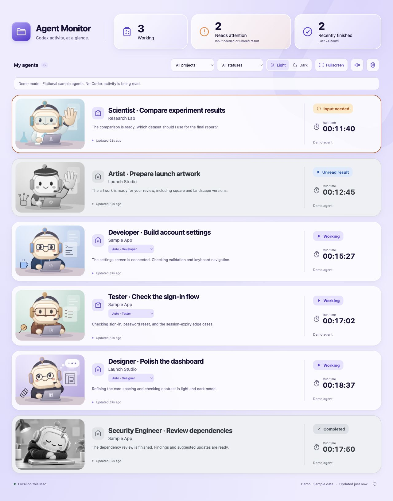
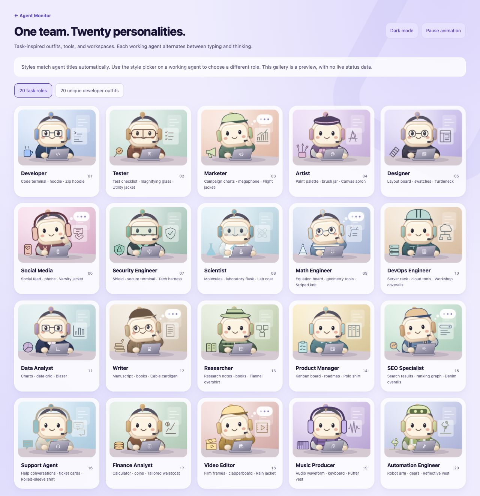
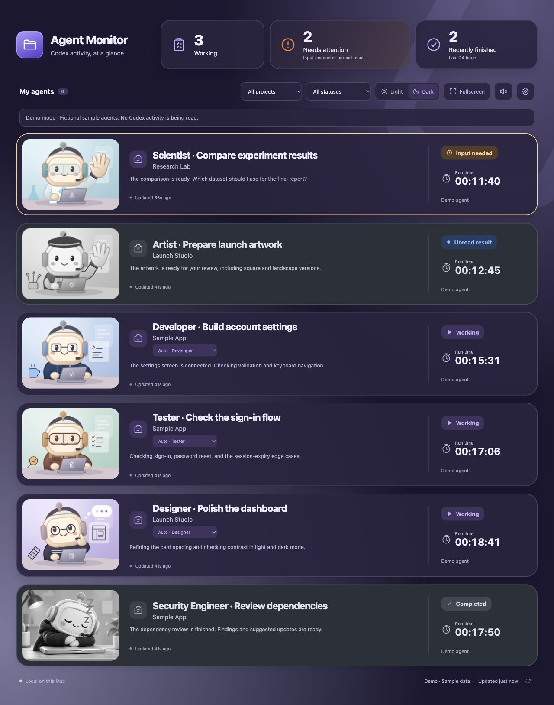

<div align="center">

# Agent Monitor

### A second-monitor home for your Codex agents.

**Designed for Codex users · Local on your Mac · Read-only · Open source**

Keep an eye on your agents while they work, wave for attention, or drift off to sleep.

[Get started](#installation) · [Ask Codex to set it up](#ask-codex-to-set-it-up) · [Features](#features) · [Contribute](CONTRIBUTING.md)

</div>



> **Experimental integration:** Agent Monitor reads local Codex journal files and desktop metadata. These are internal formats that can change. Permission approval dialogs are not detected, and failure coverage is incomplete. This is an independent community project, unaffiliated with OpenAI. See [monitoring capabilities and limitations](docs/MONITORING.md).

## Meet your second-monitor team

Running several Codex conversations creates a familiar rhythm: check progress, look for a question, open a finished result, repeat. Agent Monitor brings that activity into one compact browser window.

The reader runs as its own local process. **Updates continue when the conversation that launched it is idle.** You can close that conversation or its launching Terminal and keep the dashboard open.

The dashboard observes your agents. Prompts, approvals, and stopping runs stay in Codex.

## Features

| Feature | What you get |
| --- | --- |
| **Working** | Active local runs with their latest assistant update, project, timestamp, and elapsed time. |
| **Needs attention** | Confirmed input questions and finished agents with Codex's unread blue dot, moved to the top. |
| **Recently finished** | Normally completed runs, recognized interruptions, and explicitly reported failures. |
| **Twenty personalities** | Task-inspired working thumbnails, from Developer and Artist to Scientist and Security Engineer, plus distinct clothing identities for individual agents. |
| **A little life on your desk** | Working agents type and think. Attention agents wave. Read completed agents turn gray and sleep with floating Zzz letters. |
| **Gentle sound cues** | One completion bell; a different, two-note input-request bell. Mute, volume, and test controls included. |
| **A view that stays yours** | Project/status filters, hide-earlier option, light/dark themes, fullscreen, saved style choices, and an animation toggle. |
| **Connection awareness** | Five-second refresh, stale-state indicators, cached results on read errors, and automatic retry. |
| **Open in Codex** | Jump back to a local agent through its Codex link. |
| **Local and lightweight** | Python standard library, plain JavaScript, SVG animations, no runtime package installation, and no API key. |

Summary counts follow your filters. An unread result can appear in both Needs attention and Recently finished: one describes what needs your attention; the other describes when the run ended.

## Installation

### Requirements

- **macOS**, with the Codex desktop app installed and running.
- **Python 3.9 or newer** and **Git** available in Terminal.
- Local Codex sessions in `~/.codex`, with the [expected journal/index format](docs/MONITORING.md#compatibility).
- A current browser. Node.js 20+ is optional and only needed for JavaScript development/tests.

Check your tools:

```sh
python3 --version
git --version
```

No `pip install`, `npm install`, subscription, or API key is needed to run the dashboard.

### Clone and launch

```sh
git clone https://github.com/Krissams/agent-monitor.git
cd agent-monitor
python3 scripts/doctor.py
python3 scripts/dashboardctl.py open
```

The last command starts the background reader and opens **[http://127.0.0.1:4317](http://127.0.0.1:4317)** in your default browser.

If the compatibility check reports a problem, see [Troubleshooting](docs/TROUBLESHOOTING.md). It reads metadata and schema information without changing your Codex setup.

### Add a desktop launcher

```sh
python3 scripts/install_launcher.py
```

Double-click **Agent Monitor.command** on your Desktop whenever you want to open the dashboard. Keep the repository folder in place; the shortcut points to that checkout. The installer leaves an existing, different shortcut untouched.

You can also double-click `Launch Dashboard.command` or `Stop Dashboard.command` inside the repository. Launching at login is not installed automatically.

### Ask Codex to set it up

Prefer to stay in Codex? Copy this prompt into a Codex conversation with local workspace access:

```text
Set up Agent Monitor for me on this Mac:
https://github.com/Krissams/agent-monitor

Clone the repository into a suitable local projects folder, or use my existing
checkout. Read its README and contributor instructions, check Python and Git,
and run scripts/doctor.py. If compatible, start the dashboard, open it in my
browser, and create the desktop launcher with scripts/install_launcher.py.

Keep monitoring local and read-only. Do not change my Codex data, configuration,
hooks, permissions, or conversations. If this Codex version is incompatible,
explain the failed check and show me demo mode instead. Report the installed
location and how to start and stop it.
```

This is a setup prompt for your own Codex session, not a hosted installation service.

## Try it before connecting

Demo mode shows fictional agents and **never reads your Codex data**:

```sh
python3 server.py --demo --port 4318
```

Open **[http://127.0.0.1:4318](http://127.0.0.1:4318)**. Press **Control-C** in that Terminal to stop the demo. It uses a separate runtime directory and can run beside the live dashboard.

All dashboard screenshots in this README use demo data. The thumbnail gallery contains sample characters only.

## Twenty working styles

Each style has its own outfit or accessories, color palette, desk tools, background display, and laptop badge. They share the typing/thinking loop, with offset timing between agents.

| | | | |
| --- | --- | --- | --- |
| Developer | Tester | Marketer | Artist |
| Designer | Social Media | Security Engineer | Scientist |
| Math Engineer | DevOps Engineer | Data Analyst | Writer |
| Researcher | Product Manager | SEO Specialist | Support Agent |
| Finance Analyst | Video Editor | Music Producer | Automation Engineer |



**Auto** chooses a style from the agent title, then its latest progress snippet. It is a visual heuristic, not a role reported by Codex. Generic tasks fall back to Developer. Use the dropdown on any working card to pick another style; that choice is saved per agent in your browser.

An agent's outfit is a separate identity: active agents receive distinct garment/colorway reservations, so several Developers can still look different. Their clothing stays stable through refreshes, sorting, new runs, and role changes. Role tools and workspace details follow the selected task style. The gallery's **20 unique developer outfits** tab shows the wardrobe collection.

Reservations are assigned across the full source list before filtering and also apply when an agent waves for input or an unread result. New active agents prefer different garment shapes; additional colorways keep complete outfits unique in larger groups. Outfit allocation is tested with 100 agents of the same role, including reloads, new runs, and invalid saved assignments.

Open **Settings → Preview all 20 thumbnail styles**, or visit `/variants` on your running dashboard. The gallery includes its own theme and animation controls.

## Make it comfortable

- **Sound:** click the speaker once after opening or reloading the page. Browser audio needs that initial interaction. Existing results do not replay old alerts. Muting consumes transitions so they do not surprise you later.
- **Appearance:** choose Light or Dark, then use Fullscreen for a dedicated monitor. If the browser blocks fullscreen, macOS also supports Control-Command-F.
- **Motion:** switch off Animate agent thumbnails in Settings for a quiet view. System reduced-motion preferences are also respected.
- **Filters:** choose a project or status. Hide earlier agents keeps older finished runs out of the main view, while unread results remain visible.
- **Unread results:** open the agent in Codex to read it. The dashboard follows Codex's saved unread state on the next refresh; viewing the card alone does not mark it read.



## Start, stop, update, remove

Run these from your repository folder:

```sh
# Start the reader and open the browser
python3 scripts/dashboardctl.py open

# Start without opening a browser
python3 scripts/dashboardctl.py start

# Check the reader
python3 scripts/dashboardctl.py status

# Stop only Agent Monitor; Codex is unaffected
python3 scripts/dashboardctl.py stop
```

Closing the browser leaves the reader running. Quitting Codex makes unfinished runs stale; historical results remain available.

To update, stop the reader, run `git pull --ff-only`, and launch it again. Keep local changes committed or backed up before updating.

For foreground operation or a different port:

```sh
python3 server.py --port 4319
```

For a different Codex data directory, use `python3 server.py --codex-home /path/to/codex-data`. These foreground processes stop with Control-C.

To uninstall, stop the reader, then remove its desktop shortcut and repository folder. No global Codex hook, login item, or background service is installed outside the project.

## How it works

```text
Local Codex journals + thread index + project/unread metadata
                          ↓ read-only
                  Python reader, every 5 seconds
                          ↓ loopback HTTP
                 Browser dashboard + SVG mascots
```

The reader follows explicit run lifecycle events and completed assistant messages. It detects new runs within existing conversations. **File changes alone never mean an agent is working.** After an initial streaming scan, validated checkpoints and offsets keep subsequent reads small.

- Server: [`server.py`](server.py), Python's standard library.
- Reader: [`dashboard/journal.py`](dashboard/journal.py), read-only SQLite and JSONL.
- Interface: [`public/app.js`](public/app.js), plain JavaScript and CSS.
- Characters: [`public/mascot.js`](public/mascot.js) and [`public/roles.js`](public/roles.js), local SVGs.
- Alert deduplication: [`public/alerts.js`](public/alerts.js).

See [Monitoring](docs/MONITORING.md) for the signal contract, compatibility, persistence evidence, and remaining gaps.

## Privacy

Agent Monitor binds to **127.0.0.1 only**. It has no telemetry, remote storage, external scripts, or third-party font requests. It does not send prompts, approve requests, stop agents, or write to Codex's database.

The browser receives only monitoring fields such as titles, project labels, status, timing, short assistant updates, and pending question titles. These can still contain private work information. The reader's private `.runtime/` directory includes a checkpoint of this minimal state and a small rotating audit of state changes. Answers, command output, and reasoning are not retained as monitoring content. Browser preferences, outfit reservations, and alert identities stay in local storage.

Keep runtime directories, personal journals, and real-work screenshots out of public issues and commits. [Security and privacy details](SECURITY.md).

## Contribute a little personality

Contributions are welcome—code, artwork, compatibility reports, docs, accessibility improvements, and thoughtful bug reports all help.

Some good starting points:

- Add a role, improve its tiny desk tools, or make an existing animation clearer.
- Improve title matching without changing an agent's actual task.
- Help test a different Codex desktop version with sanitized fixtures.
- Improve keyboard navigation, reduced-motion behavior, or small-screen layouts.
- Explore a supported persistent status/event adapter with stronger approval and failure coverage.

Read [CONTRIBUTING.md](CONTRIBUTING.md), browse [issues](https://github.com/Krissams/agent-monitor/issues), or [open a pull request](https://github.com/Krissams/agent-monitor/pulls). Small, focused contributions are a great place to start.

### Development checks

```sh
python3 -m unittest discover -s tests -v
node --test tests/*.test.mjs
```

No package installation is required. CI checks parser behavior and JavaScript logic; it does not establish compatibility with every Codex installation or prove physical audio playback.

## License and credits

Released under the [MIT License](LICENSE). See [artwork credits](docs/ASSETS.md) for the included SVGs and AI-generated sleeping illustration.

Codex is an OpenAI product. Agent Monitor is an independent project made for people who use it.
