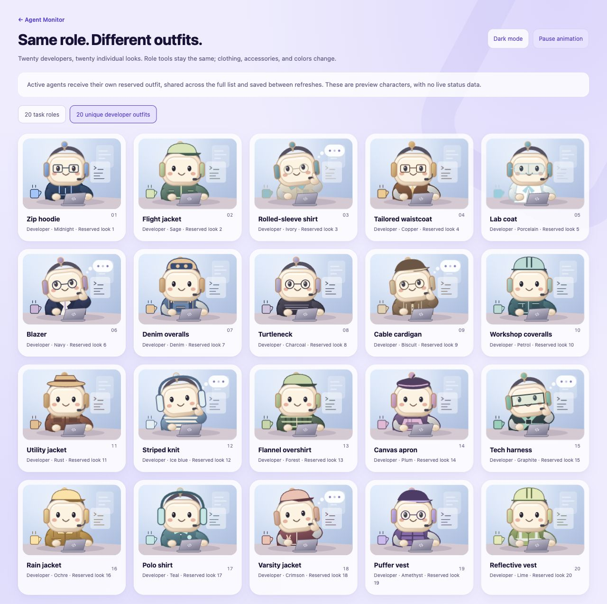

# Roles and unique agent outfits

Several agents can be Developers or Engineers without sharing the same avatar.
Agent Monitor separates the **task role** from the **reserved outfit**.

| Part of the thumbnail | What controls it |
| --- | --- |
| Task tools, workspace and laptop badge | The automatically matched role or your role selection. |
| Garment and colorway | A reservation associated with the agent's conversation ID. |
| Typing/thinking, waving or sleeping | The observed agent state. These are decorative animations. |

Changing a role does not give its outfit to another agent. A new run in the same
conversation keeps that conversation's clothing identity.

## See the collection

Start Agent Monitor and open **Settings → Preview unique developer outfits**,
or visit [the outfit gallery](http://127.0.0.1:4317/variants?view=outfits).
Use the **20 task roles** tab to compare roles instead. If you run on another
port, use `/variants?view=outfits` on that dashboard's address.

This image shows preview characters, not real conversations. All previews use
the Developer role so the differences in clothing are easy to compare.

## Twenty garment styles

| | | | |
| --- | --- | --- | --- |
| Zip hoodie | Flight jacket | Rolled-sleeve shirt | Tailored waistcoat |
| Lab coat | Blazer | Denim overalls | Turtleneck |
| Cable cardigan | Workshop coveralls | Utility jacket | Striped knit |
| Flannel overshirt | Canvas apron | Tech harness | Rain jacket |
| Polo shirt | Varsity jacket | Puffer vest | Reflective vest |

New active agents prefer garment shapes that other active agents are not using.
Additional colorways provide distinct complete outfits in larger groups. The
allocation test checks 100 simultaneous Developers for duplicate garment/colorway
keys and duplicate garment/color combinations. Larger groups can share a garment
shape while wearing different colors.

## Stable reservations

Allocation happens across the complete source snapshot **before** project,
status and hide-earlier filters are applied. Hiding an agent therefore does not
free its outfit for another visible agent.

Reservations survive polling, sorting, reloads, new runs and role changes.
Previously known agents retain their reservation when they temporarily leave
the source window. Working characters and waving input/unread-result characters
use the same reserved outfit. Read completed agents still use the shared gray
sleeping illustration with Zzz letters; they are outside the active-avatar rule.

The browser stores reservations in `agent-monitor-outfits-v1` local storage.
They are local to a browser profile and dashboard origin, so a different browser
or port can assign a different look. They are not written to Codex or synced
between Macs. Clearing the dashboard's site data resets the reservations.
Malformed or duplicated saved assignments are repaired during allocation.

## Choose a role or pause motion

Use the dropdown on a **working** agent to choose its role. **Auto** matches the
title first, then the latest progress snippet, with Developer as the fallback.
This changes the task-themed tools and workspace, while retaining the reserved
garment and colorway. It does not change the agent's instructions or permissions.

Turn off **Animate agent thumbnails** in Settings to pause the loops. System
reduced-motion preferences also stop them. The gallery has a separate preview
pause button; it does not change the saved dashboard setting.

## Implementation and checks

- [`public/outfits.js`](../public/outfits.js): garment shapes, colorways, reservations and collision repair.
- [`public/roles.js`](../public/roles.js): task roles and matching rules.
- [`public/mascot.js`](../public/mascot.js): character composition and poses.
- [`public/app.js`](../public/app.js): allocation before filtering and browser persistence.
- [`public/sequence.js`](../public/sequence.js): preservation of matching characters during refreshes.
- [`tests/outfits.test.mjs`](../tests/outfits.test.mjs): same-role uniqueness, persistence, returned agents, waiting/unread states and invalid saved assignments.

Run the focused checks with `node --test tests/outfits.test.mjs tests/roles.test.mjs`.
These tests verify allocation behavior, not compatibility with every browser or
every Codex installation. See [monitoring limitations](MONITORING.md) for the
separate status-source boundaries.
